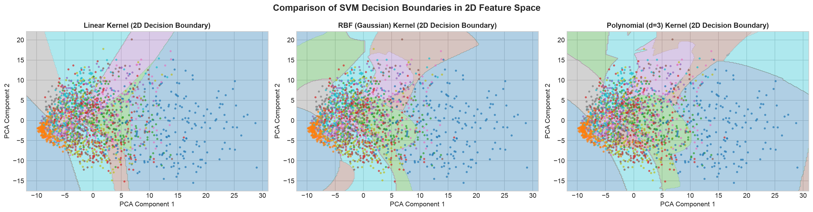
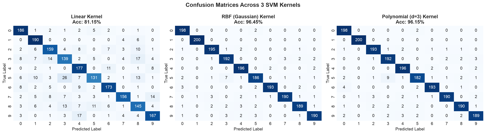

# SVM Digit Recognizer

Handwritten digit classifier on MNIST comparing **Linear**, **RBF**, and **Polynomial** Support Vector Machine kernels, reinforced with a dual **OpenCV** and **TensorFlow** image augmentation pipeline.

---

## Benchmark Results

Evaluated on 18,000 augmented training samples ($28 \times 28$ flattened to 784-dim, standardized via `StandardScaler`) and 2,000 test samples:

| Kernel | Accuracy (%) | Macro F1 | Train Time (s) | Latency (ms/sample) |
| :--- | :---: | :---: | :---: | :---: |
| **Linear** | 80.35% | 0.8023 | 119.24s | 1.120 ms |
| **RBF (Gaussian)** | **96.40%** | **0.9639** | **33.28s** | 2.392 ms |
| **Polynomial ($d=3$)** | 96.10% | 0.9609 | **22.86s** | 1.001 ms |

---

## Quickstart

### 1. Clone the Repository
```bash
git clone https://github.com/rayancloneit/svm.git
cd svm
```

### 2. Set Up Environment & Install Dependencies
Using Conda (recommended):
```bash
conda create -n cv_env python=3.11 -y
conda activate cv_env
pip install -r requirements.txt
```

Or using a standard virtual environment:
```bash
python3 -m venv venv
source venv/bin/activate
pip install -r requirements.txt
```

### 3. Run the Notebook
```bash
jupyter notebook svm_digit_recognizer.ipynb
```
Select the Python kernel and run all cells sequentially.

---

## Pipeline Overview

1. **Dataset**: MNIST ($28 \times 28$ grayscale digits 0–9).
2. **Dual Augmentation Pipeline**:
   - **OpenCV**: Affine rotations ($\pm 15^\circ$), shifts ($\pm 3$ px), morphological dilation/erosion (stroke thickness variance), and Gaussian blur.
   - **TensorFlow**: Keras layers (`RandomRotation`, `RandomTranslation`, `RandomZoom`) and additive Gaussian noise.
3. **Kernels Evaluated**:
   - **Linear**: Fast hyperplane baseline ($w^T x + b = 0$).
   - **RBF (Gaussian)**: Infinite-dimensional Hilbert space mapping ($\exp(-\gamma \|x_i - x_j\|^2)$) for non-linear stroke patterns.
   - **Polynomial ($d=3$)**: High-order feature cross-product boundary modeling.
4. **Diagnostics**:
   - Confusion matrix heatmaps across all 3 kernels.
   - 2D PCA decision boundary contour plots.
   - Robustness testing on heavily distorted digits.

---

## Visual Previews

### 2D Decision Boundaries (PCA Space)


### Confusion Matrices


---

## Repository Structure

```
.
├── LICENSE                       # MIT License
├── README.md                     # Project documentation & quickstart
├── requirements.txt              # Pinned Python package dependencies
├── outputs/                      # Generated figures & benchmark metrics
│   ├── augmentation_comparison.png
│   ├── confusion_matrices.png
│   ├── kernel_comparison_results.csv
│   ├── pca_decision_boundaries.png
│   ├── raw_digits_sample.png
│   └── robustness_test.png
└── svm_digit_recognizer.ipynb    # Main executable Jupyter Notebook
```

---

## Open Source & License

This project is licensed under the [MIT License](LICENSE). Contributions, bug reports, and issues are welcome via GitHub Issues.
